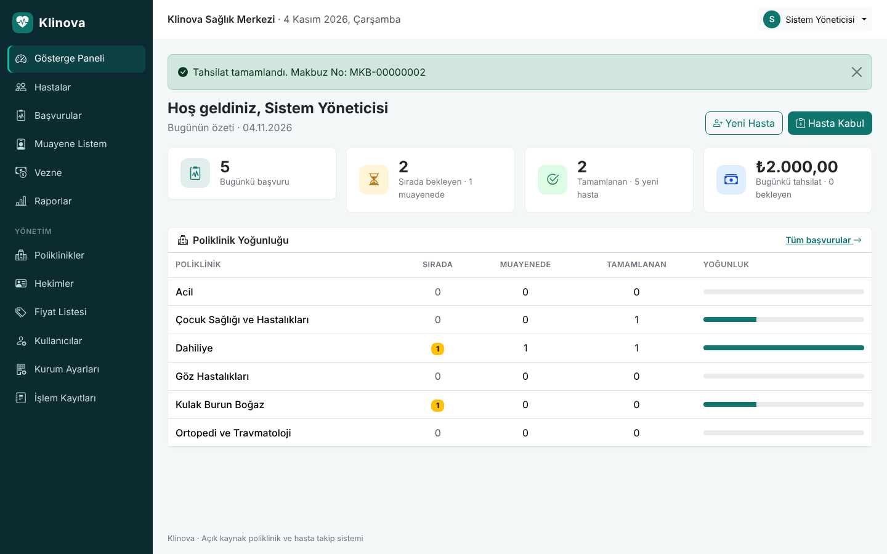
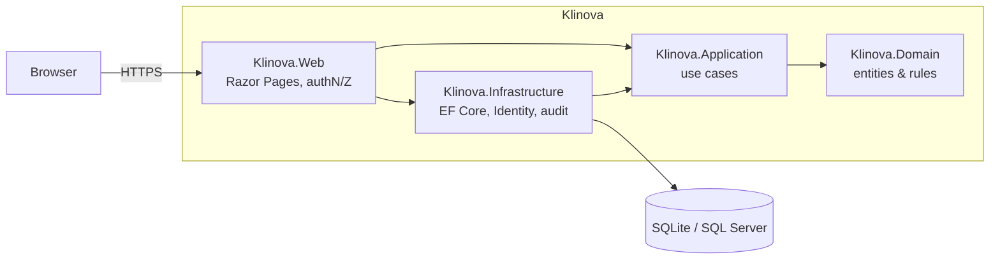

<div align="center">


# Klinova

**Open-source outpatient clinic and patient tracking system**

Patient registration, polyclinic queues, examinations, billing and revenue reports
for small and medium-sized healthcare institutions — in a single web application.

[](https://github.com/kilicchalitt/klinova/actions/workflows/ci.yml)
[](https://github.com/kilicchalitt/klinova/actions/workflows/codeql.yml)
[](https://dotnet.microsoft.com/)
[](LICENSE)

[Türkçe](README.md) · [Installation](docs/installation.md) · [User guide](docs/user-guide.md) · [Roadmap](docs/ROADMAP.md)



</div>

---

> The user interface is in Turkish and the product targets institutions in Türkiye
> (national ID validation, Turkish collation, ₺ formatting). The code base, commit
> history and technical documentation are in English.

## Highlights

- **Easy to run** — one `docker compose up`, or any Windows/Linux server with .NET 10.
  SQLite works out of the box; SQL Server is supported.
- **Many desks, one system** — reception, examination rooms and the cashier work on the
  same data from any browser, including tablets.
- **Role-based access** — *Admin*, *Reception*, *Physician* and *Cashier* only see what
  they need. Cashiers never see diagnoses or examination notes.
- **Auditable** — every insert, update and delete is recorded with user and timestamp.
- **Secure by default** — hashed passwords, lockout, rate-limited sign-in, forced password
  change for seeded accounts, strict CSP, SameSite cookies, CSRF protection, HSTS.

## Features

| Module | What it does |
| --- | --- |
| Patients | National ID (T.C. Kimlik No) checksum validation and duplicate detection, automatic file numbers, insurance, emergency contact, allergy / chronic condition alerts, archiving, accent-insensitive search |
| Admission | Polyclinic and physician selection, conflict-free daily queue number per polyclinic, initial services, printable queue slip |
| Physician work list | Today's queue, *call next patient*, complaint / diagnosis / notes, add procedures, complete or return to queue |
| Cashier | Outstanding visits, payment with discount and method, numbered receipts, end-of-day totals per payment method |
| Reports | Revenue and activity by date range, by polyclinic, physician, service and payment method, CSV export for Excel |
| Administration | Polyclinics, physicians, price list, users and roles, password reset, institution profile, audit log viewer |

## Quick start

```bash
git clone https://github.com/kilicchalitt/klinova.git
cd klinova
cp .env.example .env      # optional: set the initial admin password
docker compose up -d
```

Open <http://localhost:8080>. If no password was configured, a random one is printed once:

```bash
docker compose logs klinova | grep "Temporary password"
```

Without Docker (requires the .NET 10 SDK):

```bash
dotnet run --project src/Klinova.Web --launch-profile http
```

In the Development environment, demo data and the users `kabul`, `hekim` and `vezne`
are created; their password is printed to the console.

## Architecture



See [docs/architecture.md](docs/architecture.md), [docs/configuration.md](docs/configuration.md)
and [docs/development.md](docs/development.md).

## Contributing

Contributions are welcome — please read [CONTRIBUTING.md](CONTRIBUTING.md) and the
[Code of Conduct](CODE_OF_CONDUCT.md). Report vulnerabilities privately as described in
[SECURITY.md](SECURITY.md).

## History

Klinova started as **SOHATS**, a Windows Forms student project. It was rewritten as an
ASP.NET Core application to support multiple users, security and maintainability; see
[ADR-0001](docs/adr/0001-rewrite-as-web-application.md) and the [changelog](CHANGELOG.md).

## License

[MIT](LICENSE). Klinova is not a medical device and does not provide clinical decision support.
