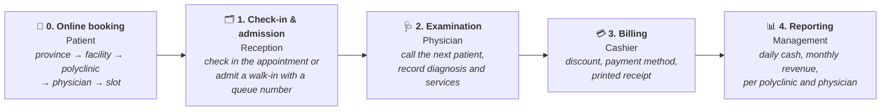

<div align="center">


# Klinova

### Online Appointments, Outpatient Clinic & Patient Tracking System

**A free, open-source web application that manages a patient's whole journey —<br/>
from the online appointment to the receipt at the cashier — for single- and multi-site institutions.**

[](https://github.com/kilicchalitt/klinova/actions/workflows/ci.yml)
[](https://github.com/kilicchalitt/klinova/actions/workflows/codeql.yml)
[](https://dotnet.microsoft.com/)
[](#-try-it-in-5-minutes)
[](LICENSE)

[**Try it in 5 minutes**](#-try-it-in-5-minutes) ·
[Features](#features) ·
[Appointment rules](#mhrs-style-appointments) ·
[Installation](docs/installation.md) ·
[Architecture](docs/architecture.md) ·
[Türkçe](README.md)

</div>

<br/>

<p align="center">
  
</p>

---

## What is Klinova?

Klinova is a patient tracking and appointment system for **hospitals, outpatient clinics, medical
centres, family health centres, private practices and company infirmaries**. It has two parts:

- **Patient portal:** patients pick province, facility, polyclinic and physician, book a free slot,
  change or cancel it, or join a waiting list — the flow patients in Türkiye know from MHRS.
- **Staff application:** front desk, physicians, cashier and management work on the same data in
  their browsers, at the same time: check-in, examination, billing and reports.

One server — or one Docker command — is all it takes; nothing is installed on the workstations,
and one installation serves all sites of an institution.

> **Language note:** the user interface is in Turkish and the product targets institutions in
> Türkiye (national ID validation, Turkish alphabetical order, ₺ formatting, KVKK). Code, commit
> history and technical documentation are in English, and multi-language UI is on the roadmap.

## How it works



## MHRS-style appointments

Klinova applies the rules patients know from Türkiye's central appointment system (MHRS) inside the
institution's own system. Every rule is configurable ([configuration](docs/configuration.md#randevu-kuralları)).

| Rule | Default |
| --- | --- |
| No-show without cancelling → no online booking in that polyclinic | 15 days |
| Repeated no-shows → restriction extended to all polyclinics | 2 within 15 days |
| Active appointments | 1 per polyclinic, 5 in total |
| Online cancellation / change | until 2 hours before |
| Waiting list | first 3 waiting patients notified when a slot is cancelled |
| Reminder | 24 hours before, in the portal inbox (and by SMS / e-mail if configured) |
| Booking horizon | 30 days online, 90 days for staff |

On top of that: physician work schedules with leave and half-day holidays, desk-only slot blocks,
check-in that opens the visit, multi-facility structure and data that stays on the institution's server.

## Screenshots

<table>
  <tr>
    <td width="50%"><br/><b>Patient portal</b>: online booking, facilities and rules.</td>
    <td width="50%"><br/><b>Appointment calendar</b>: check-in, reschedule, cancel, no-show.</td>
  </tr>
  <tr>
    <td width="50%"><br/><b>Examination</b>: medical alerts, complaint, diagnosis, notes and services on one page.</td>
    <td width="50%"><br/><b>Physician work list</b>: today's queue and one-click "call next patient".</td>
  </tr>
  <tr>
    <td><br/><b>Reports</b>: revenue and activity for any date range, CSV export.</td>
    <td><br/><b>Receipt</b>: numbered A4 receipt with institution details.</td>
  </tr>
</table>

<sub>All people and institutions shown are fictional.</sub>

## Features

- **Patient portal:** self-service registration (existing files linked only when the phone on file
  matches), booking wizard with earliest free slot, note to the physician, reschedule / cancel,
  waiting list, visit history.
- **Appointments & schedules:** weekly working blocks per physician, leave, holidays, daily calendar,
  desk booking, one-click check-in, no-show marking, reminders and notifications in the patient's portal
  inbox, optionally also by SMS (webhook) and e-mail (SMTP).
- **Facilities:** several sites with province and district in one installation.
- **Patients:** national ID checksum validation and duplicate prevention, automatic file numbers,
  insurance and emergency contact, allergy and chronic condition alerts on every screen,
  accent-insensitive search by name, file number, national ID or phone.
- **Admission:** polyclinic and physician selection, conflict-free daily queue number per
  polyclinic, printable queue slip.
- **Physicians:** today's list, one-click "call next", complaint, diagnosis, notes, services,
  previous visits.
- **Cashier:** outstanding visits, discounts and payment methods, numbered receipts,
  end-of-day totals per payment method.
- **Reports:** gross/net revenue, discounts, visit counts by polyclinic, physician, service and
  payment method; Excel-friendly CSV.
- **Administration:** polyclinics, physicians, price list (changes never alter past receipts),
  users and roles, institution profile, full audit log.

| | Patient (portal) | Reception | Physician | Cashier | Admin |
| --- | :---: | :---: | :---: | :---: | :---: |
| Book, change, cancel online; waiting list | ✅ | — | — | — | — |
| Book for patients, check in appointments | — | ✅ | — | — | ✅ |
| Register and admit patients | — | ✅ | — | — | ✅ |
| View patients and visits | — | ✅ | ✅ | ✅ | ✅ |
| Record examinations | — | — | ✅ | — | ✅ |
| Collect payments | — | ✅ | — | ✅ | ✅ |
| Revenue reports | — | — | — | ✅ | ✅ |
| Users, prices, settings, audit log | — | — | — | — | ✅ |

## 🚀 Try it in 5 minutes

Requires [Docker](https://www.docker.com/products/docker-desktop/).

```bash
git clone https://github.com/kilicchalitt/klinova.git
cd klinova
cp .env.example .env
```

Edit `.env`:

```ini
KLINOVA_ADMIN_PASSWORD=Try-Admin-2026
KLINOVA_DEMO_DATA=true
KLINOVA_DEMO_PASSWORD=Try-Demo-2026
```

```bash
docker compose up -d
```

Open <http://localhost:8080>: the **patient portal** opens. Sign in as the demo patient
(national id `10000000146`, password `KLINOVA_DEMO_PASSWORD`) or create your own account. Use
**Personel Girişi** (staff sign-in) at the bottom of the page and sign in as `admin` (Admin,
`KLINOVA_ADMIN_PASSWORD`), `kabul` (Reception), `hekim` (Physician) or `vezne` (Cashier) with
`KLINOVA_DEMO_PASSWORD`.

For production, keep demo data off, serve over HTTPS and follow the
[installation guide](docs/installation.md) (Docker, Linux/systemd, Windows/IIS, SQL Server, backups).

<details>
<summary><b>Run without Docker</b></summary>

<br/>

Requires the [.NET 10 SDK](https://dotnet.microsoft.com/download).

```bash
dotnet run --project src/Klinova.Web --launch-profile http
```

Demo data is created in the Development environment with local-only passwords from
`appsettings.Development.json`: `admin` / `Klinova-Admin-1`; `kabul`, `hekim`, `vezne` and the demo
patient `10000000146` / `Klinova-Demo-1`.
</details>

## Security & privacy

- No default credentials: the initial admin password is configured or randomly generated and must be changed at first sign-in.
- Portal accounts are linked to existing patient files only when the phone number on file matches.
- Hashed passwords, account lockout, rate-limited sign-in, role-based authorisation with a deny-by-default policy.
- CSRF protection, `HttpOnly` + `SameSite=Strict` cookies, HSTS and a strict Content-Security-Policy.
- Full audit trail; cashiers never see diagnoses or examination notes.
- Data stays on the institution's own server.

Please report vulnerabilities privately, see [SECURITY.md](SECURITY.md).

## Tech stack

ASP.NET Core 10 (Razor Pages) · Entity Framework Core 10 (SQLite or SQL Server) ·
ASP.NET Core Identity · Bootstrap 5 · xUnit (186 tests) · Docker · GitHub Actions, CodeQL, Dependabot.
See [architecture](docs/architecture.md) and [development guide](docs/development.md).

## Contributing

Bug reports, ideas, documentation and code are welcome. Read [CONTRIBUTING.md](CONTRIBUTING.md)
and the [Code of Conduct](CODE_OF_CONDUCT.md). Never share real patient data in issues.

## About

**Name:** *Klinova* = **Klin**ic + **nova** (Latin for "new").

**History:** Klinova started as **SOHATS**, a Windows Forms student project. It was rewritten with
ASP.NET Core so that a real institution can use it with many users, securely (1.0), and extended with
MHRS-style online appointments, a patient portal and multi-facility support (2.0).
See [ADR-0001](docs/adr/0001-rewrite-as-web-application.md), [ADR-0002](docs/adr/0002-appointments-and-patient-portal.md)
and the [changelog](CHANGELOG.md).

## License

[MIT](LICENSE) © Klinova contributors. Klinova is not a medical device, does not provide clinical
decision support and is not affiliated with the Turkish Ministry of Health systems (MHRS, e-Nabız, MEDULA).
