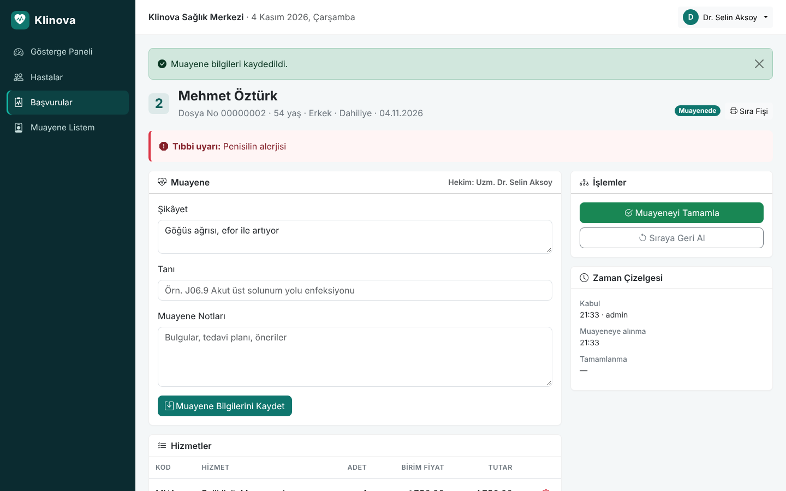
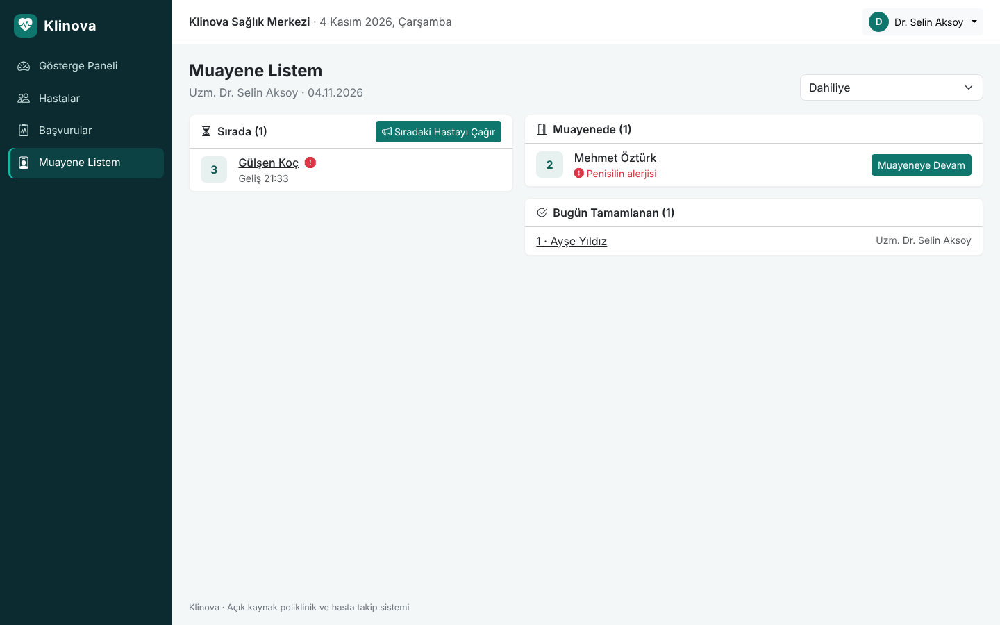
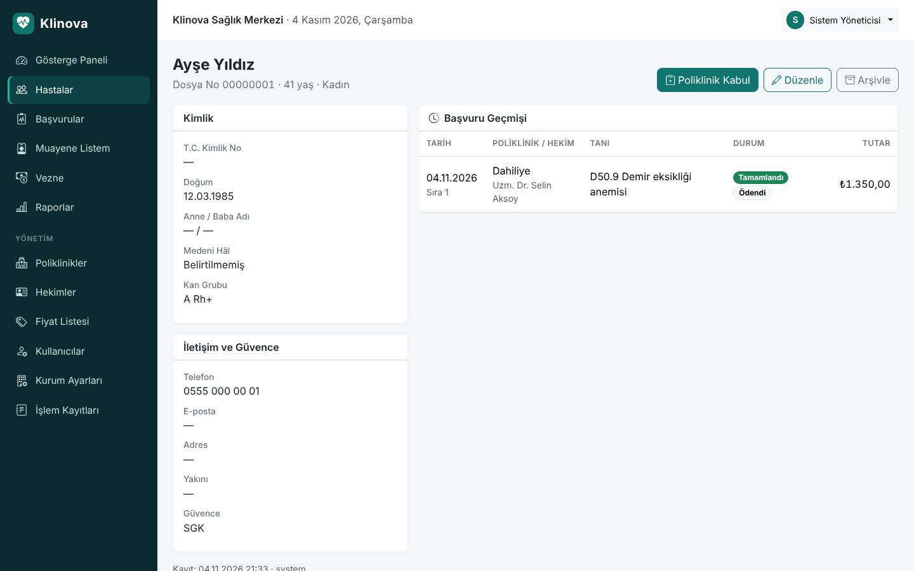
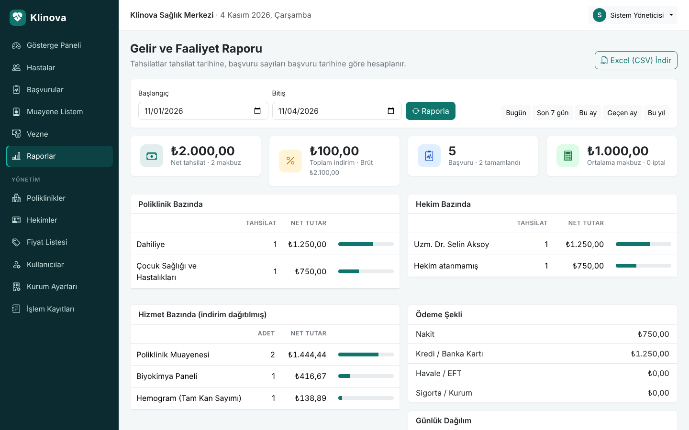
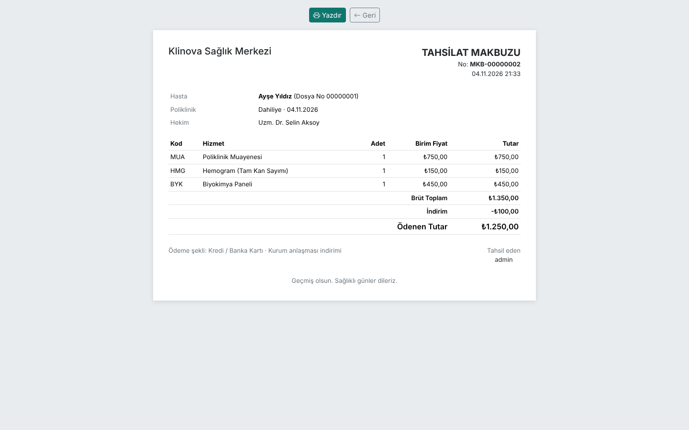
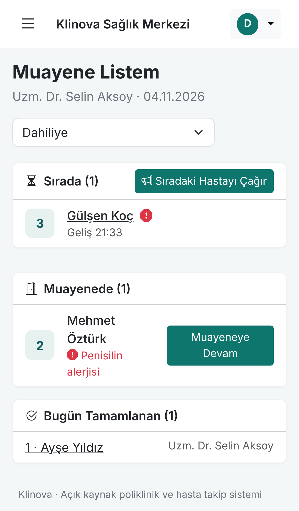
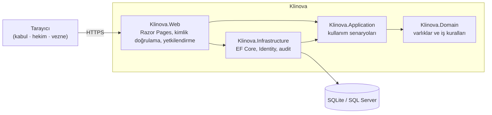

<div align="center">


# Klinova

**Açık kaynak poliklinik ve hasta takip sistemi**

Hasta kaydından poliklinik sırasına, muayeneden tahsilata ve gelir raporlarına kadar
bir sağlık kuruluşunun günlük iş akışını tek bir web uygulamasında toplar.

[](https://github.com/kilicchalitt/klinova/actions/workflows/ci.yml)
[](https://github.com/kilicchalitt/klinova/actions/workflows/codeql.yml)
[](https://dotnet.microsoft.com/)
[](LICENSE)

[English](README.en.md) · [Kurulum](docs/installation.md) · [Kullanım Kılavuzu](docs/user-guide.md) · [Yol Haritası](docs/ROADMAP.md)


</div>

---

## İçindekiler

- [Neden Klinova?](#neden-klinova)
- [Özellikler](#özellikler)
- [Ekran Görüntüleri](#ekran-görüntüleri)
- [Hızlı Başlangıç](#hızlı-başlangıç)
- [Yapılandırma](#yapılandırma)
- [Mimari](#mimari)
- [Güvenlik ve KVKK](#güvenlik-ve-kvkk)
- [Geliştirme](#geliştirme)
- [Katkıda Bulunma](#katkıda-bulunma)
- [Proje Geçmişi](#proje-geçmişi)
- [Lisans](#lisans)

## Neden Klinova?

Küçük ve orta ölçekli sağlık kuruluşları (aile sağlığı merkezleri, poliklinikler,
tıp merkezleri, kurum revirleri) için tasarlandı:

- **Kurulumu kolay.** Tek bir Docker komutuyla veya Windows/Linux sunucuda çalışır.
  Varsayılan SQLite veritabanı ek sunucu gerektirmez; dilerseniz SQL Server kullanılır.
- **Aynı anda birçok masa.** Hasta kabul, hekim odaları ve vezne aynı veriyi tarayıcı
  üzerinden eş zamanlı kullanır; tablet ve telefonda da çalışır.
- **Rol bazlı yetki.** Yönetici, Hasta Kabul, Hekim ve Vezne rolleri yalnızca kendi
  işlerine ait ekranları görür.
- **Denetlenebilir.** Her ekleme, güncelleme ve silme kimin tarafından ne zaman yapıldığıyla
  birlikte kayda geçer.
- **Türkiye'ye uygun.** T.C. Kimlik No doğrulaması, Türkçe arayüz, Türkçe alfabetik sıralama,
  ₺ biçimi ve İstanbul saat dilimine göre günlük sıra numarası.

## Özellikler

| Modül | Öne çıkanlar |
| --- | --- |
| **Hasta kaydı** | T.C. Kimlik No algoritma doğrulaması ve mükerrer kayıt engeli · otomatik dosya numarası · güvence (SGK / özel sigorta / kurum) · yakın bilgisi · alerji ve kronik hastalık uyarıları · arşivleme |
| **Hasta arama** | Ad soyad (Türkçe karakter duyarsız: *ismail* = *İSMAİL* = *Ismail*), dosya no, T.C. Kimlik No veya telefon ile tek kutudan arama, sayfalama |
| **Poliklinik kabul** | Poliklinik ve hekim seçimi · her poliklinik için günlük, çakışmasız sıra numarası · başlangıç hizmetleri · yazdırılabilir sıra fişi |
| **Hekim ekranı** | Günün sırası · "Sıradaki Hastayı Çağır" · şikâyet, tanı ve muayene notları · hizmet/tetkik ekleme · tıbbi uyarıların belirgin gösterimi |
| **Vezne** | Tahsilat bekleyen başvurular · indirim ve ödeme şekli · numaralı A4 makbuz · ödeme şekline göre gün sonu kasa dökümü |
| **Raporlar** | Tarih aralığına göre net/brüt gelir, indirim, başvuru sayıları · poliklinik, hekim, hizmet ve ödeme şekli kırılımları · Excel uyumlu CSV dışa aktarma |
| **Yönetim** | Poliklinik, hekim ve fiyat listesi yönetimi · kullanıcı ve rol yönetimi · şifre sıfırlama · kurum bilgileri · işlem kayıtları (audit log) |

## Ekran Görüntüleri

| Hekim muayene ekranı | Hekim çalışma listesi |
| --- | --- |
|  |  |
| **Hasta kartı ve başvuru geçmişi** | **Gelir raporu** |
|  |  |
| **Tahsilat makbuzu** | **Mobil görünüm** |
|  |  |

> Ekran görüntülerindeki tüm kişi ve kurum bilgileri kurgusaldır.

## Hızlı Başlangıç

### Docker ile (önerilen)

```bash
git clone https://github.com/kilicchalitt/klinova.git
cd klinova
cp .env.example .env    # isteğe bağlı: ilk yönetici şifresini belirleyin
docker compose up -d
```

Uygulama <http://localhost:8080> adresinde açılır. `.env` içinde şifre belirtmediyseniz
ilk yönetici şifresi bir kez rastgele üretilip loga yazılır:

```bash
docker compose logs klinova | grep "Temporary password"
```

İlk girişte bu geçici şifreyi değiştirmeniz istenir.

### .NET SDK ile

[.NET 10 SDK](https://dotnet.microsoft.com/download) gereklidir.

```bash
git clone https://github.com/kilicchalitt/klinova.git
cd klinova
dotnet run --project src/Klinova.Web --launch-profile http
```

Geliştirme ortamında örnek veriler (poliklinikler, hekimler, hastalar) ve `kabul`,
`hekim`, `vezne` demo kullanıcıları otomatik oluşturulur; şifreleri konsol çıktısındadır.

Sunucuya kurulum (Windows Server / IIS, Linux / systemd, ters vekil sunucu, yedekleme)
için [Kurulum Rehberi](docs/installation.md)'ne bakın.

## Yapılandırma

Tüm ayarlar `appsettings.json` dosyasından veya ortam değişkenlerinden okunur
(ör. `Klinova__TimeZone`). Repoda hiçbir parola veya gizli anahtar bulunmaz.

| Ayar | Varsayılan | Açıklama |
| --- | --- | --- |
| `Database:Provider` | `Sqlite` | `Sqlite` veya `SqlServer` |
| `ConnectionStrings:Default` | `Data Source=data/klinova.db` | Veritabanı bağlantısı |
| `Klinova:TimeZone` | `Europe/Istanbul` | İş günü ve sıra numaralarının sıfırlandığı saat dilimi |
| `Klinova:Seed:AdminPassword` | *(boş → rastgele)* | İlk yönetici şifresi |
| `Klinova:Seed:DemoData` | `false` | Örnek veri ve demo kullanıcılar |
| `Klinova:DataProtectionKeysPath` | `data/keys` | Oturum çerezlerini şifreleyen anahtarların klasörü |

Tam liste: [docs/configuration.md](docs/configuration.md)

## Mimari



| Katman | Sorumluluk |
| --- | --- |
| `Klinova.Domain` | Hasta, başvuru, tahsilat gibi varlıklar; başvuru yaşam döngüsü ve faturalama kuralları; T.C. Kimlik No doğrulaması |
| `Klinova.Application` | Hasta kaydı, kabul, muayene, tahsilat, raporlama senaryoları |
| `Klinova.Infrastructure` | EF Core eşlemeleri ve migration'lar, ASP.NET Core Identity, denetim kaydı, başlangıç verileri |
| `Klinova.Web` | Razor Pages arayüzü, güvenlik başlıkları, rol politikaları |

Ayrıntılar: [docs/architecture.md](docs/architecture.md)

## Güvenlik ve KVKK

- Şifreler ASP.NET Core Identity ile tuzlanmış hash olarak saklanır; 5 hatalı denemede hesap kilitlenir, giriş istekleri IP bazında sınırlandırılır.
- Seed edilen veya sıfırlanan hesaplar ilk girişte şifre değiştirmek zorundadır.
- Sıkı Content-Security-Policy, `X-Frame-Options`, `SameSite=Strict` çerezler, CSRF koruması ve HSTS.
- Hekim dışındaki roller tanı ve muayene notlarını göremez (veri minimizasyonu).
- Tüm veri değişiklikleri işlem kayıtlarında saklanır.

Klinova özel nitelikli kişisel veri (sağlık verisi) işler. Kurulum yapan kuruluşun
KVKK yükümlülükleri için [SECURITY.md](SECURITY.md) ve
[Kurulum Rehberi](docs/installation.md#güvenlik-kontrol-listesi) içindeki kontrol listesine bakın.
Güvenlik açığı bildirimleri için lütfen herkese açık issue açmayın; [SECURITY.md](SECURITY.md)'yi izleyin.

## Geliştirme

```bash
dotnet tool restore     # dotnet-ef
dotnet build
dotnet test             # birim, entegrasyon ve HTTP uçtan uca testleri
```

Migration ekleme, kodlama standartları ve proje yapısı: [docs/development.md](docs/development.md)

## Katkıda Bulunma

Katkılarınızı bekliyoruz! Lütfen önce [CONTRIBUTING.md](CONTRIBUTING.md) ve
[Davranış Kuralları](CODE_OF_CONDUCT.md)'nı okuyun. Hata bildirimleri ve öneriler için
[issue](https://github.com/kilicchalitt/klinova/issues/new/choose) açabilirsiniz.

## Proje Geçmişi

Klinova, **SOHATS** (*Sağlık Ocağı Hasta Takip Sistemi*) adlı Windows Forms tabanlı bir
öğrenci projesi olarak başladı. Prototip; çok kullanıcılı kullanım, güvenlik ve bakım
kolaylığı gereksinimlerini karşılayacak şekilde ASP.NET Core ile baştan yazıldı.
Gerekçeler [ADR-0001](docs/adr/0001-rewrite-as-web-application.md)'de, değişiklikler
[CHANGELOG.md](CHANGELOG.md)'de yer alır. Eski masaüstü sürümünün kaynak kodu Git
geçmişinde korunmaktadır.

## Lisans

[MIT](LICENSE) lisansı ile dağıtılmaktadır.

> **Sorumluluk reddi:** Klinova bir tıbbi cihaz değildir ve klinik karar desteği sağlamaz.
> Üretim ortamında kullanmadan önce kurumunuzun mevzuat, KVKK ve bilgi güvenliği
> gereksinimlerini değerlendirin.
