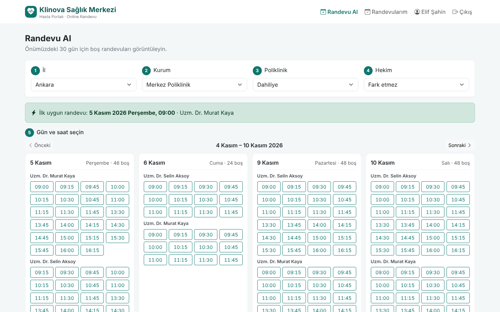
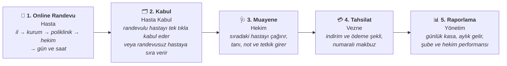
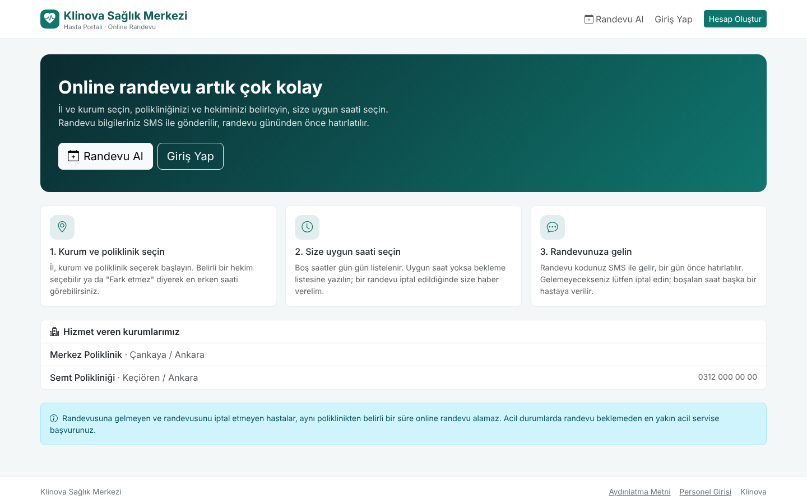
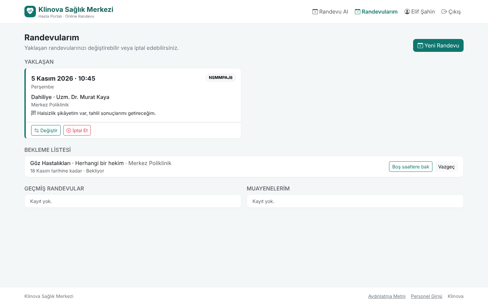
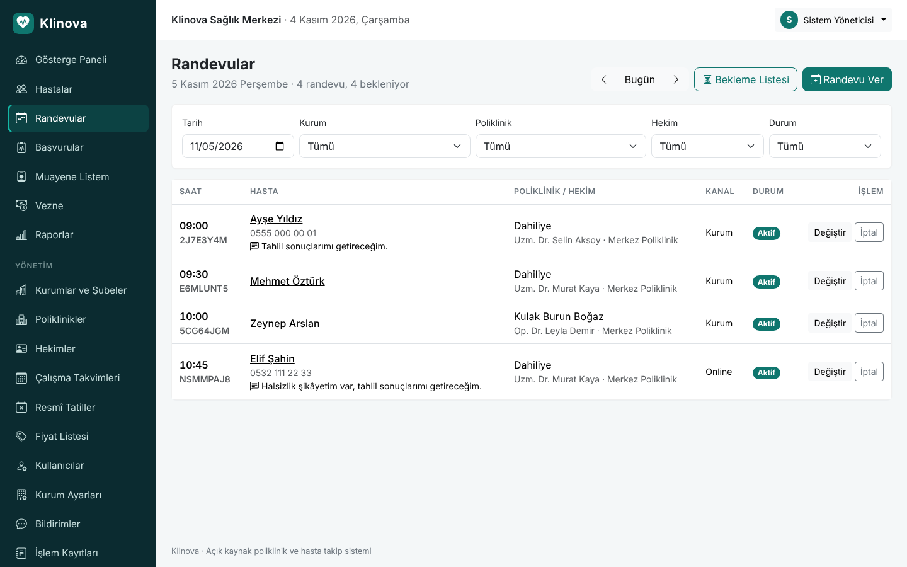
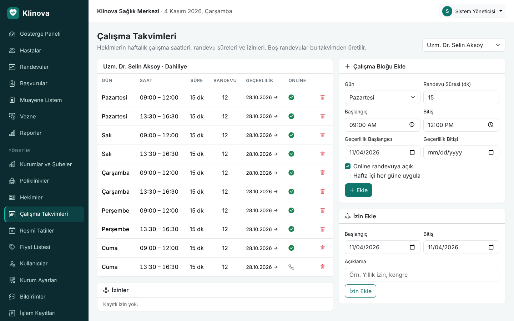
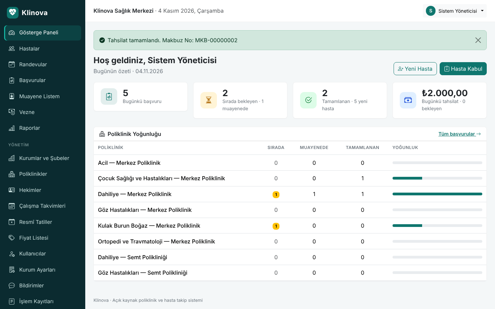

<div align="center">


# Klinova

### Online Randevu, Poliklinik ve Hasta Takip Sistemi

**Hastanın online randevu almasından makbuzunu alıp çıkışına kadar tüm süreci yöneten,<br/>
tek veya çok şubeli sağlık kuruluşları için ücretsiz ve açık kaynak web uygulaması.**

[](https://github.com/kilicchalitt/klinova/actions/workflows/ci.yml)
[](https://github.com/kilicchalitt/klinova/actions/workflows/codeql.yml)
[](https://dotnet.microsoft.com/)
[](#-5-dakikada-deneyin)
[](LICENSE)

[**5 Dakikada Deneyin**](#-5-dakikada-deneyin) ·
[Özellikler](#özellikler) ·
[Randevu Kuralları](#mhrs-tarzı-randevu-sistemi) ·
[Kurulum Rehberi](docs/installation.md) ·
[Kullanım Kılavuzu](docs/user-guide.md) ·
[English](README.en.md)

</div>

<br/>

<p align="center">
  
</p>

---

## Klinova nedir?

Klinova; **hastane, poliklinik, tıp merkezi, aile sağlığı merkezi, muayenehane ve kurum revirleri**
için geliştirilmiş bir hasta takip ve randevu sistemidir. İki parçadan oluşur:

- **Hasta Portalı:** Hastalar MHRS'ye benzer bir akışla il, kurum, poliklinik ve hekim seçip online
  randevu alır, randevusunu değiştirir veya iptal eder. Uygun saat yoksa bekleme listesine yazılır.
- **Kurum Uygulaması:** Danışma, hekim, vezne ve yönetim aynı sistemi tarayıcı üzerinden, aynı anda
  kullanır. Randevulu hasta kabulden geçer, muayene olur, tahsilat yapılır, raporlar oluşur.

Tek bir sunucu (ya da tek bir Docker komutu) yeterlidir; istemcilere hiçbir şey kurulmaz.
Birden fazla bina veya şubesi olan kurumlar tüm şubelerini tek kurulumdan yönetir.

| Klinova'dan önce | Klinova ile |
| --- | --- |
| Randevular telefonla, deftere yazılarak verilir | Hastalar 7/24 online randevu alır; telefonla arayanlara personel aynı takvimden randevu verir |
| Gelmeyen hastaların saatleri boşa gider | Gelmeyen hastaya kısıtlama uygulanır, iptal edilen saat bekleme listesindeki hastalara bildirilir |
| Hekim çalışma saatleri ve izinler kâğıtta tutulur | Haftalık çalışma takvimi, izin ve resmî tatiller tanımlanır; boş saatler otomatik hesaplanır |
| Hasta bilgileri defterde veya dağınık Excel dosyalarında | Tüm hastalar tek kayıtta; ad, dosya no, T.C. Kimlik No veya telefonla saniyeler içinde bulunur |
| Hekim, hastanın alerjisini sözlü olarak öğrenir | Alerji ve kronik hastalık uyarısı her ekranda kırmızı olarak görünür |
| Gün sonu kasa ve aylık gelir elle hesaplanır | Şube, poliklinik, hekim ve hizmet bazında raporlar tek tıkla, Excel'e aktarılabilir |
| "Bu kaydı kim değiştirdi?" sorusunun cevabı yoktur | Her değişiklik kim tarafından, ne zaman yapıldığıyla kayıt altındadır |

## Nasıl çalışır?



## MHRS tarzı randevu sistemi

Klinova, Türkiye'de hastaların Merkezi Hekim Randevu Sistemi'nden (MHRS) alışık olduğu kuralları
kurumun kendi randevu sisteminde uygular. Bütün kurallar kurum tarafından ayarlanabilir
([yapılandırma](docs/configuration.md#randevu-kuralları)).

| Kural | Klinova'daki karşılığı (varsayılan) |
| --- | --- |
| Randevuya gitmeyen hasta aynı branştan bir süre randevu alamaz | **15 gün** aynı poliklinikten online randevu kısıtlaması |
| Tekrarlayan gelmemelerde kısıtlama genişler | 15 gün içinde **2 gelmeme** → tüm polikliniklerden kısıtlama |
| Aynı branşta aynı anda tek aktif randevu | Poliklinik başına **1** aktif randevu, hasta başına toplam **5** |
| Randevu belirli süre öncesine kadar iptal edilebilir | Randevudan **2 saat** öncesine kadar online iptal/değişiklik |
| Uygun randevu yoksa bekleme listesi | Bekleme listesi; iptal edilen saat **ilk 3 bekleyen** hastaya bildirilir |
| "Fark etmez" hekim seçimi, ilk uygun randevu | Hekim seçmeden tüm hekimlerin saatleri; **ilk uygun randevu** öne çıkarılır |
| Hekime not | Hasta randevu alırken hekime not bırakabilir |
| Randevu hatırlatma | Randevudan **24 saat** önce portal bildirimi (tanımlıysa SMS / e-posta) |
| İleri tarihli randevu | Online **30 gün**, kurum personeli **90 gün** ileriye randevu verebilir |

**Klinova'nın ek olarak sağladıkları:** randevunun kabul, muayene, vezne ve raporlama ile aynı
sistemde olması; çok şubeli yapı (il → ilçe → kurum); hekim bazında haftalık çalışma takvimi,
yarım gün tatil ve izin yönetimi; yalnızca kurum içinden (telefon/danışma) verilebilen randevu
blokları; tüm kuralların kurum tarafından ayarlanabilmesi ve verilerin kurumun kendi sunucusunda kalması.

## Ekran Görüntüleri

<table>
  <tr>
    <td width="50%"><br/><b>Hasta portalı</b>: online randevu, kurumlar ve kurallar.</td>
    <td width="50%"><br/><b>Randevularım</b>: değiştir / iptal et, bekleme listesi, geçmiş muayeneler.</td>
  </tr>
  <tr>
    <td><br/><b>Randevu takvimi</b>: kabul, değiştir, iptal, "gelmedi" işaretleme.</td>
    <td><br/><b>Çalışma takvimi</b>: haftalık bloklar, randevu süresi, izinler.</td>
  </tr>
  <tr>
    <td><br/><b>Muayene ekranı</b>: tıbbi uyarı, şikâyet, tanı, notlar ve hizmetler tek sayfada.</td>
    <td><br/><b>Hekim çalışma listesi</b>: tek tıkla "Sıradaki Hastayı Çağır".</td>
  </tr>
  <tr>
    <td><br/><b>Gösterge paneli</b>: günün başvuruları, randevuları, tahsilatı ve şube yoğunluğu.</td>
    <td><br/><b>Raporlar</b>: şube, poliklinik, hekim ve hizmet bazında gelir.</td>
  </tr>
  <tr>
    <td><br/><b>Tahsilat makbuzu</b>: kurum bilgileriyle numaralı A4 makbuz.</td>
    <td align="center"><br/><b>Telefonda online randevu</b></td>
  </tr>
</table>

<sub>Görüntülerdeki tüm kişi ve kurum bilgileri kurgusaldır.</sub>

## Özellikler

### 📱 Hasta Portalı (Online Randevu)
- T.C. Kimlik No ile hesap oluşturma; kurumda kaydı olan hasta, **kayıtlı telefon numarası eşleşirse** dosyasına bağlanır
- Adım adım randevu: **il → kurum → poliklinik → hekim ("fark etmez") → gün → saat**
- Haftalık boş saat görünümü, **ilk uygun randevu**, hekime not
- Randevu **değiştirme ve iptal** (son iptal süresine kadar), **bekleme listesi**
- Geçmiş randevular ve muayeneler, iletişim bilgileri, KVKK aydınlatma metni onayı
- Boş saatler giriş yapmadan görülebilir; telefon ve tablet uyumlu

### 📅 Randevu ve Çalışma Takvimi
- Hekim bazında **haftalık çalışma blokları**: gün, saat aralığı, randevu süresi, geçerlilik tarihi
- Blok bazında "online randevuya açık" veya "yalnızca kurum" seçeneği
- **İzinler** ve **resmî tatiller** (yarım gün dahil); sabit tarihli millî bayramlar otomatik eklenir
- Günlük randevu takvimi: kurum, poliklinik, hekim ve durum filtresi
- Telefonla veya danışmadan randevu verme, değiştirme, iptal (hastaya bildirim)
- **Randevulu hasta kabulü**: tek tıkla başvuru açılır ve sıra numarası verilir
- **"Gelmedi" işaretleme** ve gün sonunda otomatik işaretleme

### 🔔 Bildirimler
- Randevu onayı, **24 saat önce hatırlatma**, iptal ve bekleme listesi mesajları
- Hasta portalında **Bildirimlerim** bölümü ve okunmamış bildirim sayacı; ek sağlayıcı gerekmez
- İsteğe bağlı SMS (operatör API'si için HTTP webhook) ve e-posta (SMTP), gönderim kuyruğu ve otomatik tekrar deneme

### 🗂️ Hasta Kayıt ve Kabul
- T.C. Kimlik No **algoritmik doğrulama** ve **mükerrer kayıt engeli**
- Otomatik dosya numarası; kimlik, iletişim, güvence (SGK, özel sigorta, kurum) ve yakın bilgileri
- **Tıbbi uyarılar:** alerji ve kronik hastalıklar tüm ekranlarda belirgin şekilde gösterilir
- Tek kutudan arama (Türkçe karakter duyarsız: *ismail* = *İSMAİL* = *Ismail*)
- Randevusuz hastalar için poliklinik kabulü, **günlük otomatik sıra numarası**, sıra fişi

### 🩺 Hekim
- Kendi polikliniğinin günlük listesi ve randevu takvimi
- **"Sıradaki Hastayı Çağır"**, şikâyet, tanı ve muayene notu, tetkik ve işlem ekleme
- Hastanın önceki başvuruları, tanıları ve hekime bıraktığı not

### 💳 Vezne ve 📊 Raporlar
- Tahsilat bekleyenler, indirim, ödeme şekli, **numaralı makbuz**, gün sonu kasa dökümü
- Tarih aralığına göre brüt/net gelir; **şube, poliklinik, hekim, hizmet ve ödeme şekli** kırılımları; Excel uyumlu CSV

### ⚙️ Yönetim
- **Kurumlar ve şubeler** (il, ilçe, adres), poliklinikler, hekimler, fiyat listesi
- Kullanıcı ve rol yönetimi, tek seferlik geçici şifre, şifre sıfırlama, hesap pasifleştirme
- **İşlem kayıtları:** her ekleme/değişiklik/silme işleminin eski ve yeni değeriyle dökümü

### Roller ve Yetkiler

| | Hasta (Portal) | Hasta Kabul | Hekim | Vezne | Yönetici |
| --- | :---: | :---: | :---: | :---: | :---: |
| Online randevu, değiştirme, iptal, bekleme listesi | ✅ | — | — | — | — |
| Hasta adına randevu, randevulu hasta kabulü | — | ✅ | — | — | ✅ |
| Randevu takvimini görüntüleme | — | ✅ | ✅ | — | ✅ |
| Hasta kaydı ve poliklinik kabul | — | ✅ | — | — | ✅ |
| Muayene kaydı (tanı, notlar) | — | — | ✅ | — | ✅ |
| Tahsilat ve makbuz | — | ✅ | — | ✅ | ✅ |
| Gelir raporları | — | — | — | ✅ | ✅ |
| Kurumlar, çalışma takvimleri, kullanıcılar, ayarlar | — | — | — | — | ✅ |

<sub>Hastalar personel ekranlarına, personel hesapları hasta portalına erişemez. Vezne tanı ve muayene notlarını göremez (KVKK veri minimizasyonu).</sub>

## 🚀 5 Dakikada Deneyin

Bilgisayarınızda [Docker](https://www.docker.com/products/docker-desktop/) kurulu olması yeterlidir.

**1. Projeyi indirin**

```bash
git clone https://github.com/kilicchalitt/klinova.git
cd klinova
cp .env.example .env
```

**2. `.env` dosyasında demo modunu açın ve şifreleri belirleyin**

```ini
KLINOVA_ADMIN_PASSWORD=Deneme-Yonetici-1
KLINOVA_DEMO_DATA=true
KLINOVA_DEMO_PASSWORD=Deneme-Demo-1
```

**3. Başlatın**

```bash
docker compose up -d
```

**4. Tarayıcıda <http://localhost:8080> adresini açın.**

- Açılan sayfa **hasta portalıdır**. *Hesap Oluştur* ile bir test hastası oluşturup randevu alabilirsiniz
  (test için algoritmaya uygun bir numara kullanın, örn. `10000000146`).
- Kurum uygulaması için sayfanın altındaki **Personel Girişi** bağlantısını kullanın:

| Kullanıcı adı | Rol | Şifre |
| --- | --- | --- |
| `admin` | Yönetici | `KLINOVA_ADMIN_PASSWORD` (ilk girişte değiştirmeniz istenir) |
| `kabul` | Hasta Kabul | `KLINOVA_DEMO_PASSWORD` |
| `hekim` | Hekim (Dahiliye) | `KLINOVA_DEMO_PASSWORD` |
| `vezne` | Vezne | `KLINOVA_DEMO_PASSWORD` |

Demo verisi iki şube (Merkez Poliklinik ve Semt Polikliniği), hafta içi çalışma takvimli hekimler
ve örnek randevular içerir.

> **Gerçek kullanım için** demo modunu kapalı tutun (`KLINOVA_DEMO_DATA=false`), uygulamayı
> HTTPS arkasında yayınlayın, SMS/e-posta sağlayıcınızı tanımlayın ve [Kurulum Rehberi](docs/installation.md)'ndeki
> güvenlik kontrol listesini uygulayın.

<details>
<summary><b>Docker olmadan çalıştırmak (geliştiriciler için)</b></summary>

<br/>

[.NET 10 SDK](https://dotnet.microsoft.com/download) gereklidir.

```bash
git clone https://github.com/kilicchalitt/klinova.git
cd klinova
dotnet run --project src/Klinova.Web --launch-profile http
```

Uygulama <http://localhost:5080> adresinde açılır. Geliştirme ortamında demo verisi otomatik
oluşturulur; yönetici ve demo kullanıcı şifreleri konsola bir kez yazılır.

</details>

## Sistem Gereksinimleri

| | Önerilen |
| --- | --- |
| **Sunucu** | 2 çekirdek, 2 GB RAM, 10 GB disk (küçük kurum); çok şubeli kurumlarda 4 çekirdek, 4 GB+ |
| **İşletim sistemi** | Docker çalıştıran her sistem, Linux veya Windows Server 2019+ |
| **Veritabanı** | Dahili SQLite (ek kurulum gerekmez) veya Microsoft SQL Server 2019+ |
| **İstemci** | Güncel Chrome, Edge, Firefox veya Safari; masaüstü, tablet veya telefon |

## Güvenlik ve KVKK

Sağlık verisi, KVKK kapsamında **özel nitelikli kişisel veridir**. Klinova bu sorumluluk gözetilerek tasarlandı:

- 🔐 **Varsayılan şifre yok.** İlk yönetici şifresi kurulumda belirlenir veya rastgele üretilir; ilk girişte değiştirilmesi zorunludur.
- 🔒 Şifreler geri döndürülemez şekilde (hash) saklanır. 5 hatalı denemede hesap kilitlenir, giriş ve kayıt denemeleri sınırlandırılır.
- 🪪 **Portal hesabı ele geçirmeye karşı koruma:** T.C. Kimlik No, ad ve doğum tarihi gizli bilgi olmadığından, mevcut hasta dosyasına bağlanmak için kurumda kayıtlı telefon numarasının da eşleşmesi gerekir.
- 👥 Rol bazlı yetkilendirme; hasta ve personel alanları birbirinden tamamen ayrıdır.
- 🧾 Tüm veri değişiklikleri işlem kayıtlarında saklanır; bildirim içerikleri bilgi düzeyindeki loglara yazılmaz.
- 🛡️ CSRF koruması, güvenli çerezler, HSTS ve sıkı içerik güvenlik politikası (CSP).
- 🏠 Veriler kurumunuzun kendi sunucusunda kalır.

Kurum olarak yapmanız gerekenler (HTTPS, yedekleme, aydınlatma metni, VERBİS vb.) için
[güvenlik kontrol listesine](docs/installation.md#güvenlik-kontrol-listesi) bakın.
Güvenlik açığı bulduysanız lütfen herkese açık issue açmayın; [SECURITY.md](SECURITY.md)'deki adımları izleyin.

## Teknik Bilgiler

| | |
| --- | --- |
| **Altyapı** | ASP.NET Core 10, Razor Pages, Entity Framework Core 10, ASP.NET Core Identity |
| **Arayüz** | Bootstrap 5, Bootstrap Icons. Harici CDN yok, kapalı kurum ağında da çalışır |
| **Veritabanı** | SQLite (varsayılan) veya SQL Server; şema migration'larla otomatik ve veri kaybetmeden güncellenir |
| **Arka plan işleri** | Bildirim gönderimi, randevu hatırlatma, "gelmedi" işaretleme, bekleme listesi süresi |
| **Mimari** | Katmanlı yapı: `Domain` → `Application` → `Infrastructure` → `Web` |
| **Kalite** | 185 otomatik test (birim, entegrasyon, uçtan uca HTTP), CI, CodeQL, Dependabot |
| **Dağıtım** | Docker imajı (root olmayan kullanıcı), docker compose, IIS, systemd |

Ayrıntılar: [Mimari](docs/architecture.md) · [Yapılandırma](docs/configuration.md) · [Geliştirme](docs/development.md)

## Yol Haritası

Sıradaki sürümlerde planlananlar: **e-Devlet ile giriş** ve SMS doğrulama kodu, **ICD-10 tanı kataloğu**,
laboratuvar sonuçlarının portalda gösterilmesi, reçete ve tetkik istem formları, bekleme salonu sıra
ekranı, PDF çıktı, PostgreSQL desteği ve çok dilli arayüz. Tam liste: [docs/ROADMAP.md](docs/ROADMAP.md)

## Sık Sorulan Sorular

<details>
<summary><b>Klinova MHRS'nin yerine mi geçer?</b></summary>

Hayır. MHRS, Sağlık Bakanlığı'nın kamu hastaneleri için merkezi randevu sistemidir. Klinova ise bir
kurumun (özel poliklinik, tıp merkezi, vakıf/üniversite birimi, kurum revir vb.) kendi randevu ve hasta
takip sistemidir; MHRS'den alışık olunan kuralları kurum içinde uygular. MHRS entegrasyonu yol haritasında
ayrı ve isteğe bağlı bir modül olarak yer alır.
</details>

<details>
<summary><b>Klinova ücretli mi?</b></summary>

Hayır. MIT lisansı ile tamamen ücretsizdir; kurumunuzda kullanabilir, değiştirebilir ve dağıtabilirsiniz.
</details>

<details>
<summary><b>SMS sağlayıcısı gerekli mi?</b></summary>

Gerekmez: portal hesabı olan hastalar tüm mesajları hasta portalındaki **Bildirimlerim** bölümünde görür.
İsterseniz SMS operatörünüzün HTTP API'sine bağlanan bir webhook adresi ve/veya SMTP sunucusu tanımlayarak
aynı mesajları SMS ve e-posta ile de gönderebilirsiniz ([yapılandırma](docs/configuration.md#bildirimler)).
</details>

<details>
<summary><b>Birden fazla şubemiz var, tek kurulum yeterli mi?</b></summary>

Evet. Her şube il ve ilçesiyle tanımlanır; poliklinikler şubelere bağlanır. Hastalar online randevuda önce
il ve kurum seçer; raporlar ve gösterge paneli şube bazında ayrışır.
</details>

<details>
<summary><b>İnternet bağlantısı gerekir mi?</b></summary>

Kurum uygulaması yerel ağda internetsiz çalışabilir. Hastaların online randevu alabilmesi için hasta
portalının internete (HTTPS ile) açılması gerekir.
</details>

<details>
<summary><b>Verilerimi nasıl yedeklerim?</b></summary>

SQLite kullanıyorsanız tek bir veritabanı dosyasını ve anahtar klasörünü yedeklemeniz yeterlidir;
SQL Server'da kurumunuzun standart yedekleme planı geçerlidir. Komutlar
[Kurulum Rehberi](docs/installation.md#yedekleme-ve-geri-yükleme)'nde.
</details>

## Katkıda Bulunun

Hata bildirimi, öneri, çeviri, belge veya kod. Her katkı değerli.
Başlamadan önce [CONTRIBUTING.md](CONTRIBUTING.md) ve [Davranış Kuralları](CODE_OF_CONDUCT.md)'nı okuyun,
ardından bir [issue](https://github.com/kilicchalitt/klinova/issues/new/choose) açın.
Issue ve pull request'lerde **gerçek hasta verisi paylaşmayın.**

## Proje Hakkında

**İsim:** *Klinova* = **Klin**ik + **nova** (Latince "yeni"). Yeni nesil, modern klinik yönetimi.

**Geçmiş:** Proje, **SOHATS** (*Sağlık Ocağı Hasta Takip Sistemi*) adlı Windows Forms tabanlı bir
öğrenci projesi olarak başladı. Gerçek bir kurumda çok kullanıcılı, güvenli ve bakımı kolay
şekilde kullanılabilmesi için ASP.NET Core ile baştan yazıldı (1.0) ve MHRS tarzı online randevu,
hasta portalı ve çok şubeli yapı ile genişletildi (2.0). Gerekçeler
[ADR-0001](docs/adr/0001-rewrite-as-web-application.md) ve [ADR-0002](docs/adr/0002-appointments-and-patient-portal.md)'de,
sürüm notları [CHANGELOG.md](CHANGELOG.md)'de yer alır.

## Lisans

[MIT](LICENSE) © Klinova katkıcıları

> **Sorumluluk reddi:** Klinova bir tıbbi cihaz değildir, klinik karar desteği sağlamaz ve Sağlık
> Bakanlığı sistemleriyle (MHRS, e-Nabız, MEDULA) resmî bir bağlantısı yoktur. Üretim ortamında
> kullanmadan önce kurumunuzun mevzuat, KVKK ve bilgi güvenliği gereksinimlerini değerlendirin.
