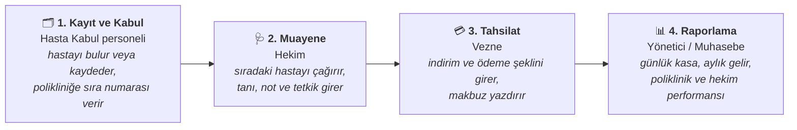

<div align="center">


# Klinova

### Poliklinik ve Hasta Takip Sistemi

**Hastanın kapıdan girişinden makbuzunu alıp çıkışına kadar tüm süreci yöneten,<br/>
ücretsiz ve açık kaynak web uygulaması.**

[](https://github.com/kilicchalitt/klinova/actions/workflows/ci.yml)
[](https://github.com/kilicchalitt/klinova/actions/workflows/codeql.yml)
[](https://dotnet.microsoft.com/)
[](#-5-dakikada-deneyin)
[](LICENSE)

[**5 Dakikada Deneyin**](#-5-dakikada-deneyin) ·
[Özellikler](#özellikler) ·
[Kurulum Rehberi](docs/installation.md) ·
[Kullanım Kılavuzu](docs/user-guide.md) ·
[English](README.en.md)

</div>

<br/>

<p align="center">
  
</p>

---

## Klinova nedir?

Klinova; **poliklinik, tıp merkezi, aile sağlığı merkezi, özel muayenehane ve kurum revirleri**
için geliştirilmiş bir hasta takip sistemidir. Danışmadaki kayıt personeli, muayene odasındaki
hekim ve vezne aynı sistemi **tarayıcı üzerinden, aynı anda** kullanır. Kurulum için tek bir
sunucu (ya da tek bir Docker komutu) yeterlidir; istemcilere hiçbir şey kurulmaz.

Kâğıt sıra fişlerinin, Excel listelerinin ve tek bilgisayara bağlı eski programların yerini alır:

| Klinova'dan önce | Klinova ile |
| --- | --- |
| Hasta bilgileri defterde veya dağınık Excel dosyalarında | Tüm hastalar tek kayıtta; ad, dosya no, T.C. Kimlik No veya telefonla saniyeler içinde bulunur |
| Sıra numaraları elle verilir, karışıklık olur | Her poliklinik için günlük, otomatik ve çakışmasız sıra numarası |
| Hekim, hastanın alerjisini sözlü olarak öğrenir | Alerji ve kronik hastalık uyarısı her ekranda kırmızı olarak görünür |
| Vezne hangi hastanın ne kadar ödeyeceğini sorar | Muayenesi biten hasta vezne listesine otomatik düşer, tutar hazırdır |
| Gün sonu kasa ve aylık gelir elle hesaplanır | Poliklinik, hekim ve hizmet bazında raporlar tek tıkla, Excel'e aktarılabilir |
| "Bu kaydı kim değiştirdi?" sorusunun cevabı yoktur | Her değişiklik kim tarafından, ne zaman yapıldığıyla kayıt altındadır |

## Nasıl çalışır?

Bir hastanın Klinova'daki yolculuğu dört adımdan oluşur. Her adımı farklı bir personel,
kendi ekranından yürütür:



## Ekran Görüntüleri

<table>
  <tr>
    <td width="50%"><br/><b>Muayene ekranı</b> — tıbbi uyarı, şikâyet, tanı, notlar ve hizmetler tek sayfada.</td>
    <td width="50%"><br/><b>Hekim çalışma listesi</b> — sırada bekleyenler ve tek tıkla "Sıradaki Hastayı Çağır".</td>
  </tr>
  <tr>
    <td><br/><b>Hasta kartı</b> — kimlik, iletişim, güvence ve tüm başvuru geçmişi.</td>
    <td><br/><b>Raporlar</b> — tarih aralığına göre gelir ve faaliyet, CSV dışa aktarma.</td>
  </tr>
  <tr>
    <td><br/><b>Tahsilat makbuzu</b> — kurum bilgileriyle numaralı A4 makbuz.</td>
    <td align="center"><br/><b>Tablet ve telefon</b> — muayene odasında da kullanılabilir.</td>
  </tr>
</table>

<sub>Görüntülerdeki tüm kişi ve kurum bilgileri kurgusaldır.</sub>

## Özellikler

### 🗂️ Hasta Kayıt ve Kabul
- T.C. Kimlik No **algoritmik doğrulama** ve **mükerrer kayıt engeli** (aynı kişi iki kez kaydedilemez)
- Otomatik dosya numarası; kimlik, iletişim, güvence (SGK, özel sigorta, kurum) ve yakın bilgileri
- **Tıbbi uyarılar:** alerji ve kronik hastalıklar tüm ekranlarda belirgin şekilde gösterilir
- Tek kutudan arama: ad soyad, dosya no, T.C. Kimlik No veya telefon.
  Türkçe karakter duyarsız: *ismail*, *İSMAİL* ve *Ismail* aynı sonucu verir
- Poliklinik ve hekim seçerek kabul, **günlük otomatik sıra numarası**, yazdırılabilir sıra fişi

### 🩺 Hekim
- Kendi polikliniğinin günlük listesi: sırada, muayenede, tamamlanan
- **"Sıradaki Hastayı Çağır"** ile tek tıkla hasta çağırma
- Şikâyet, tanı ve muayene notu kaydı; tetkik ve işlem ekleme
- Hastanın önceki başvuruları ve tanıları

### 💳 Vezne
- Muayenesi tamamlanan ve ödeme bekleyen hastalar listesi
- İndirim, ödeme şekli (nakit, kart, havale, sigorta/kurum) ve açıklama
- Kurum bilgileriyle **numaralı makbuz** (MKB-00000001)
- Ödeme şekline göre **gün sonu kasa dökümü**

### 📊 Raporlar
- Seçilen tarih aralığında brüt/net gelir, indirim, başvuru ve iptal sayıları
- **Poliklinik, hekim, hizmet ve ödeme şekli** kırılımları, günlük dağılım
- Hazır aralıklar (bugün, son 7 gün, bu ay, geçen ay, bu yıl) ve **Excel uyumlu CSV**

### ⚙️ Yönetim
- Poliklinik, hekim ve **fiyat listesi** yönetimi. Fiyat değişikliği geçmiş makbuzları etkilemez
- Kullanıcı ve rol yönetimi, tek seferlik geçici şifre, şifre sıfırlama, hesap pasifleştirme
- Kurum adı, adresi, vergi bilgileri ve makbuz notu
- **İşlem kayıtları:** her ekleme/değişiklik/silme işleminin eski ve yeni değeriyle dökümü

### Roller ve Yetkiler

Her personel yalnızca kendi işine ait ekranları görür. Bir kullanıcıya birden fazla rol verilebilir.

| | Hasta Kabul | Hekim | Vezne | Yönetici |
| --- | :---: | :---: | :---: | :---: |
| Hasta kaydı ve poliklinik kabul | ✅ | — | — | ✅ |
| Hasta ve başvuru görüntüleme | ✅ | ✅ | ✅ | ✅ |
| Muayene kaydı (tanı, notlar) | — | ✅ | — | ✅ |
| Tahsilat ve makbuz | ✅ | — | ✅ | ✅ |
| Gelir raporları | — | — | ✅ | ✅ |
| Kullanıcılar, fiyatlar, kurum ayarları, işlem kayıtları | — | — | — | ✅ |

<sub>Vezne, tanı ve muayene notlarını göremez (KVKK veri minimizasyonu).</sub>

## 🚀 5 Dakikada Deneyin

Bilgisayarınızda [Docker](https://www.docker.com/products/docker-desktop/) kurulu olması yeterlidir.

**1. Projeyi indirin**

```bash
git clone https://github.com/kilicchalitt/klinova.git
cd klinova
cp .env.example .env
```

**2. `.env` dosyasında demo modunu açın ve şifreleri belirleyin**

```ini
KLINOVA_ADMIN_PASSWORD=Deneme-Yonetici-1
KLINOVA_DEMO_DATA=true
KLINOVA_DEMO_PASSWORD=Deneme-Demo-1
```

**3. Başlatın**

```bash
docker compose up -d
```

**4. Tarayıcıda <http://localhost:8080> adresini açın** ve rolleri deneyin:

| Kullanıcı adı | Rol | Şifre |
| --- | --- | --- |
| `admin` | Yönetici | `KLINOVA_ADMIN_PASSWORD` (ilk girişte değiştirmeniz istenir) |
| `kabul` | Hasta Kabul | `KLINOVA_DEMO_PASSWORD` |
| `hekim` | Hekim (Dahiliye) | `KLINOVA_DEMO_PASSWORD` |
| `vezne` | Vezne | `KLINOVA_DEMO_PASSWORD` |

Örnek akış: `kabul` ile bir hastayı Dahiliye'ye kabul edin → `hekim` ile *Muayene Listem*'den
çağırıp muayeneyi tamamlayın → `vezne` ile tahsilat yapıp makbuzu yazdırın.

> **Gerçek kullanım için** demo modunu kapalı tutun (`KLINOVA_DEMO_DATA=false`), uygulamayı
> HTTPS arkasında yayınlayın ve [Kurulum Rehberi](docs/installation.md)'ndeki güvenlik kontrol
> listesini uygulayın. Windows Server (IIS), Linux (systemd), SQL Server, yedekleme ve güncelleme
> adımları da bu rehberdedir.

<details>
<summary><b>Docker olmadan çalıştırmak (geliştiriciler için)</b></summary>

<br/>

[.NET 10 SDK](https://dotnet.microsoft.com/download) gereklidir.

```bash
git clone https://github.com/kilicchalitt/klinova.git
cd klinova
dotnet run --project src/Klinova.Web --launch-profile http
```

Uygulama <http://localhost:5080> adresinde açılır. Geliştirme ortamında demo verisi otomatik
oluşturulur; yönetici ve demo kullanıcı şifreleri konsola bir kez yazılır.

</details>

## Sistem Gereksinimleri

| | Önerilen |
| --- | --- |
| **Sunucu** | 2 çekirdek, 2 GB RAM, 10 GB disk (≈10 eş zamanlı kullanıcı) |
| **İşletim sistemi** | Docker çalıştıran her sistem, Linux veya Windows Server 2019+ |
| **Veritabanı** | Dahili SQLite (ek kurulum gerekmez) veya Microsoft SQL Server 2019+ |
| **İstemci** | Güncel Chrome, Edge, Firefox veya Safari; masaüstü, tablet veya telefon |

## Güvenlik ve KVKK

Sağlık verisi, KVKK kapsamında **özel nitelikli kişisel veridir**. Klinova bu sorumluluk
gözetilerek tasarlandı:

- 🔐 **Varsayılan şifre yok.** İlk yönetici şifresi kurulumda belirlenir veya rastgele üretilir; ilk girişte değiştirilmesi zorunludur.
- 🔒 Şifreler geri döndürülemez şekilde (hash) saklanır. 5 hatalı denemede hesap kilitlenir, giriş denemeleri sınırlandırılır.
- 👥 Rol bazlı yetkilendirme; her sayfa varsayılan olarak giriş ister.
- 🧾 Tüm veri değişiklikleri işlem kayıtlarında saklanır.
- 🛡️ CSRF koruması, güvenli çerezler, HSTS ve sıkı içerik güvenlik politikası (CSP).
- 🏠 Veriler kurumunuzun kendi sunucusunda kalır; harici bir servise gönderilmez.

Kurum olarak yapmanız gerekenler (HTTPS, yedekleme, aydınlatma metni, VERBİS vb.) için
[güvenlik kontrol listesine](docs/installation.md#güvenlik-kontrol-listesi) bakın.
Güvenlik açığı bulduysanız lütfen herkese açık issue açmayın; [SECURITY.md](SECURITY.md)'deki adımları izleyin.

## Teknik Bilgiler

| | |
| --- | --- |
| **Altyapı** | ASP.NET Core 10, Razor Pages, Entity Framework Core 10, ASP.NET Core Identity |
| **Arayüz** | Bootstrap 5, Bootstrap Icons. Harici CDN yok, kapalı kurum ağında da çalışır |
| **Veritabanı** | SQLite (varsayılan) veya SQL Server; şema migration'larla otomatik güncellenir |
| **Mimari** | Katmanlı yapı: `Domain` → `Application` → `Infrastructure` → `Web` |
| **Kalite** | 116 otomatik test (birim, entegrasyon, uçtan uca HTTP), CI, CodeQL, Dependabot |
| **Dağıtım** | Docker imajı (root olmayan kullanıcı), docker compose, IIS, systemd |

Ayrıntılar: [Mimari](docs/architecture.md) · [Yapılandırma](docs/configuration.md) · [Geliştirme](docs/development.md)

## Yol Haritası

Sıradaki sürümlerde planlananlar: **randevu sistemi**, **ICD-10 tanı kataloğu**, reçete ve
laboratuvar istem formları, bekleme salonu sıra ekranı, PDF çıktı, PostgreSQL desteği ve
çok dilli arayüz. Tam liste: [docs/ROADMAP.md](docs/ROADMAP.md)

## Sık Sorulan Sorular

<details>
<summary><b>Klinova ücretli mi?</b></summary>

Hayır. MIT lisansı ile tamamen ücretsizdir; kurumunuzda kullanabilir, değiştirebilir ve dağıtabilirsiniz.
</details>

<details>
<summary><b>İnternet bağlantısı gerekir mi?</b></summary>

Hayır. Klinova kurumunuzun yerel ağındaki bir sunucuda çalışabilir. Tüm dosyalar uygulamanın
içinde gelir, harici bir servise bağlanmaz.
</details>

<details>
<summary><b>e-Nabız / MEDULA entegrasyonu var mı?</b></summary>

Henüz yok. Resmî sistem entegrasyonları yol haritasında, ayrı ve isteğe bağlı modüller olarak planlanmaktadır.
</details>

<details>
<summary><b>Verilerimi nasıl yedeklerim?</b></summary>

SQLite kullanıyorsanız tek bir veritabanı dosyasını ve anahtar klasörünü yedeklemeniz yeterlidir;
SQL Server'da kurumunuzun standart yedekleme planı geçerlidir. Komutlar
[Kurulum Rehberi](docs/installation.md#yedekleme-ve-geri-yükleme)'nde.
</details>

<details>
<summary><b>Kaç kullanıcı aynı anda çalışabilir?</b></summary>

SQLite ile küçük kurumlar (yaklaşık 10 eş zamanlı kullanıcı) rahatça çalışır.
Daha büyük kurumlar için SQL Server önerilir.
</details>

## Katkıda Bulunun

Hata bildirimi, öneri, çeviri, belge veya kod. Her katkı değerli.
Başlamadan önce [CONTRIBUTING.md](CONTRIBUTING.md) ve [Davranış Kuralları](CODE_OF_CONDUCT.md)'nı okuyun,
ardından bir [issue](https://github.com/kilicchalitt/klinova/issues/new/choose) açın.
Issue ve pull request'lerde **gerçek hasta verisi paylaşmayın.**

## Proje Hakkında

**İsim:** *Klinova* = **Klin**ik + **nova** (Latince "yeni"). Yeni nesil, modern klinik yönetimi.

**Geçmiş:** Proje, **SOHATS** (*Sağlık Ocağı Hasta Takip Sistemi*) adlı Windows Forms tabanlı bir
öğrenci projesi olarak başladı. Gerçek bir kurumda çok kullanıcılı, güvenli ve bakımı kolay
şekilde kullanılabilmesi için ASP.NET Core ile baştan yazıldı. Gerekçeler
[ADR-0001](docs/adr/0001-rewrite-as-web-application.md)'de, sürüm notları
[CHANGELOG.md](CHANGELOG.md)'de yer alır.

## Lisans

[MIT](LICENSE) © Klinova katkıcıları

> **Sorumluluk reddi:** Klinova bir tıbbi cihaz değildir ve klinik karar desteği sağlamaz.
> Üretim ortamında kullanmadan önce kurumunuzun mevzuat, KVKK ve bilgi güvenliği
> gereksinimlerini değerlendirin.
