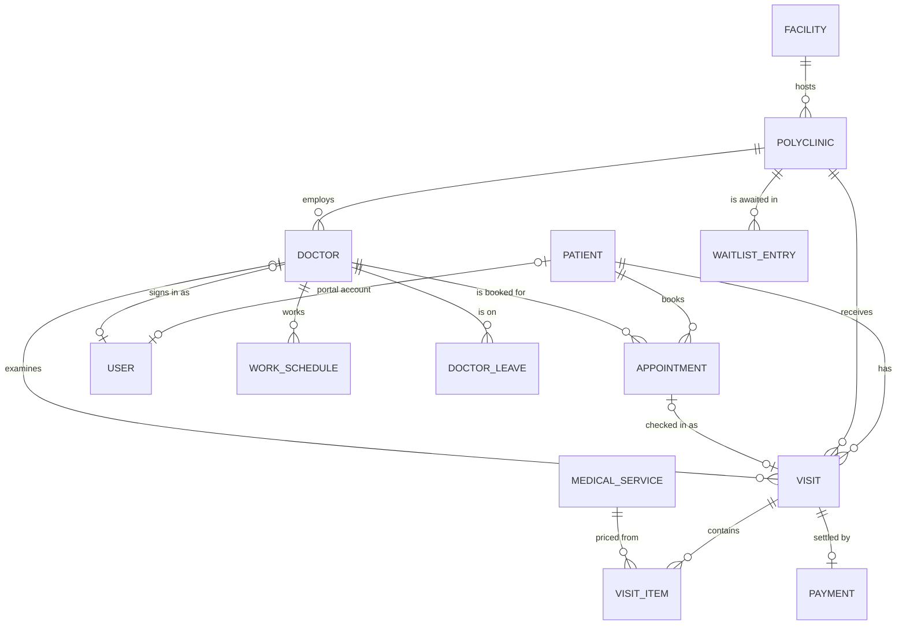
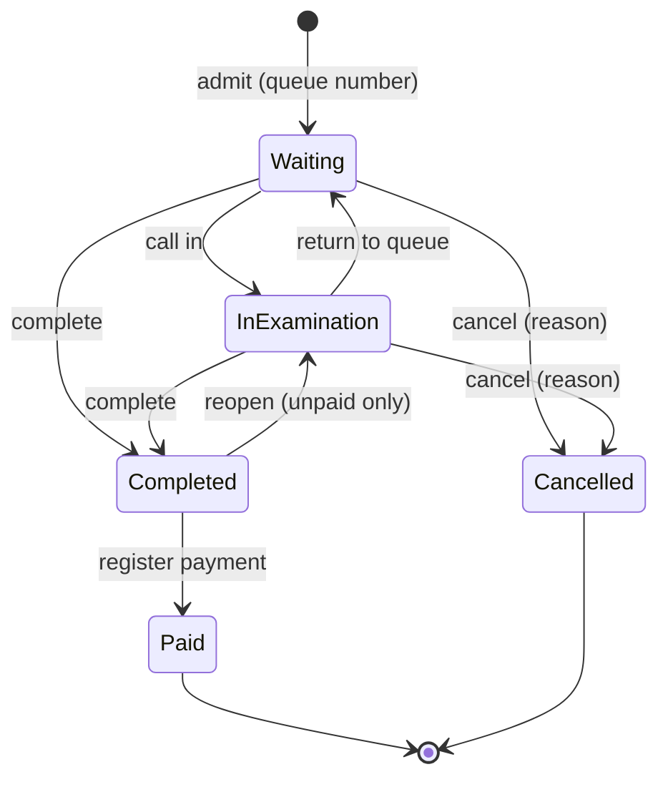
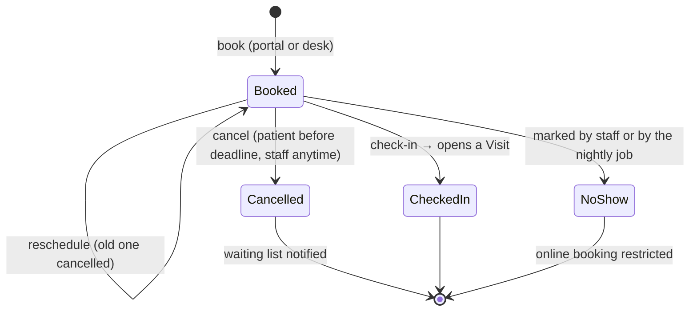

# Architecture

Klinova is a server-rendered ASP.NET Core application organised in four layers.
Dependencies point inwards: the domain knows nothing about persistence or the web.

```
src/
├── Klinova.Domain          Entities, enums and business rules. No dependencies.
├── Klinova.Application     Use cases (services), input models, abstractions.
├── Klinova.Infrastructure  EF Core, ASP.NET Core Identity, auditing, seeding.
└── Klinova.Web             Razor Pages UI, authentication, security middleware.
tests/
├── Klinova.Domain.Tests        Pure unit tests of business rules.
├── Klinova.Application.Tests   Use cases against an in-memory SQLite database built from the migrations.
└── Klinova.Web.Tests           HTTP tests with WebApplicationFactory (security, roles, flows).
```

## Domain model



| Entity | Notes |
| --- | --- |
| `Patient` | File number is derived from the key (`00000042`). National id is optional, validated and unique. `SearchName` holds a folded, upper-case copy of the name for accent-insensitive search on every provider. |
| `Polyclinic`, `Doctor`, `MedicalService` | Reference data; deactivated instead of deleted. |
| `Visit` | Aggregate root of the clinical workflow (see below). |
| `VisitItem` | Snapshot of service code, name and unit price at the time it was added. |
| `Payment` | One per visit (unique index). Gross, discount, net, method, cashier. |
| `AuditLog` | Who changed what, written automatically. |
| `InstitutionProfile` | Single row with the details printed on receipts. |
| `Facility` | A site (hospital, campus building, branch clinic) with province and district. |
| `WorkSchedule`, `DoctorLeave`, `Holiday` | Weekly working blocks, leave and full / half-day holidays; expanded into free slots by `SlotCalculator`. |
| `Appointment` | A booked slot with confirmation code, channel (online / desk), note to the physician and lifecycle (booked, checked in, cancelled, no-show). |
| `WaitlistEntry` | A patient waiting for a slot in a polyclinic (optionally a physician) within a date range. |
| `Notification` | Outbox entry for SMS / e-mail delivery with retries. |

### Visit lifecycle



### Appointment lifecycle



Booking rules live in `AppointmentService` and are configured by `AppointmentPolicy`
(see [configuration](configuration.md#randevu-kuralları)). A filtered unique index on
`(DoctorId, Date, StartTime)` for non-cancelled appointments prevents double booking.

### Visit rules

The rules live in `Visit` and are covered by `tests/Klinova.Domain.Tests/VisitTests.cs`:
services cannot change once a visit is paid, a payment requires a completed visit with
at least one service, discounts must be between zero and the gross total, etc.

## Key design decisions

| Decision | Rationale |
| --- | --- |
| Razor Pages, no SPA | Simple deployment, no JavaScript build chain, works on any browser, strict CSP without inline scripts. |
| SQLite by default, SQL Server optional | A small clinic needs no database server; larger institutions use their existing SQL Server. Each provider has its own migration set (`SqliteAppDbContext`, `SqlServerAppDbContext`). |
| Times stored in UTC, business day as `DateOnly` | Queue numbers reset at local midnight (`Klinova:TimeZone`) regardless of server time zone. |
| Unique index + retry for queue numbers | Two desks admitting at the same time never get the same number, without provider-specific locking. |
| Money aggregated in memory after date filtering | SQLite cannot aggregate `decimal`; results stay identical on every provider. |
| Price snapshot on visit items | Price-list changes do not rewrite history or issued receipts. |
| Audit via `SaveChangesInterceptor` | Every change is captured without touching the use cases; audit rows share the transaction of the change. |
| Business errors as `DomainException` | User-facing Turkish messages raised by the domain, shown as form errors or alerts by the web layer. |
| Slots computed, not stored | Changing a schedule, adding leave or a holiday takes effect immediately; only appointments are persisted. |
| Outbox for notifications | Messages are saved with the change that caused them and delivered asynchronously with retries; a failing SMS provider never breaks a booking. |
| Portal in the same application, separated by policies | One deployment and one database; the fallback policy requires a staff role, the portal requires the patient role. |

See also [ADR-0001](adr/0001-rewrite-as-web-application.md) and [ADR-0002](adr/0002-appointments-and-patient-portal.md).

## Background jobs

Two hosted services run inside the web process (disable with `Klinova:BackgroundJobs:Enabled`):

| Job | Interval | Work |
| --- | --- | --- |
| `NotificationDispatchWorker` | 30 s | Sends pending outbox messages through the configured SMS / e-mail senders. |
| `AppointmentMaintenanceWorker` | 10 min | Marks missed appointments as no-show, queues reminders, expires waiting-list requests. |

## Request pipeline

1. Request localisation (`tr-TR`) and forwarded headers.
2. Exception handler / status code pages (production).
3. Security headers (CSP, frame, referrer, permissions policies), HTTPS redirection, HSTS.
4. Static files, routing, rate limiting (sign-in page).
5. Authentication (Identity cookie) and authorisation (role policies, authenticated fallback policy).
6. Forced password change redirect for flagged accounts.
7. Razor Pages with a page filter that maps `NotFoundException` to 404 and `DomainException` on POST to an alert.

## Security model

| Area | Policy | Roles |
| --- | --- | --- |
| Everything not listed below | `Staff` (fallback policy) | Admin, Reception, Physician, Cashier |
| `/Portal/*` (except landing, sign-in, registration, privacy notice and slot browsing) | `Patient` | Patient |
| `/Appointments` | `AppointmentView` | Admin, Reception, Physician |
| `/Appointments/Book`, `/Appointments/Waitlist` | `AppointmentDesk` | Admin, Reception |
| `/Patients/Create`, `/Patients/Edit`, `/Visits/Admit` | `PatientRegistration` | Admin, Reception |
| `/Worklist` | `ClinicalWork` | Admin, Physician |
| `/Billing` | `Billing` | Admin, Cashier, Reception |
| `/Reports` | `Reporting` | Admin, Cashier |
| `/Admin` | `Administration` | Admin |

Actions inside shared pages (e.g. recording an examination on the visit page) are
additionally checked in the page handlers.
