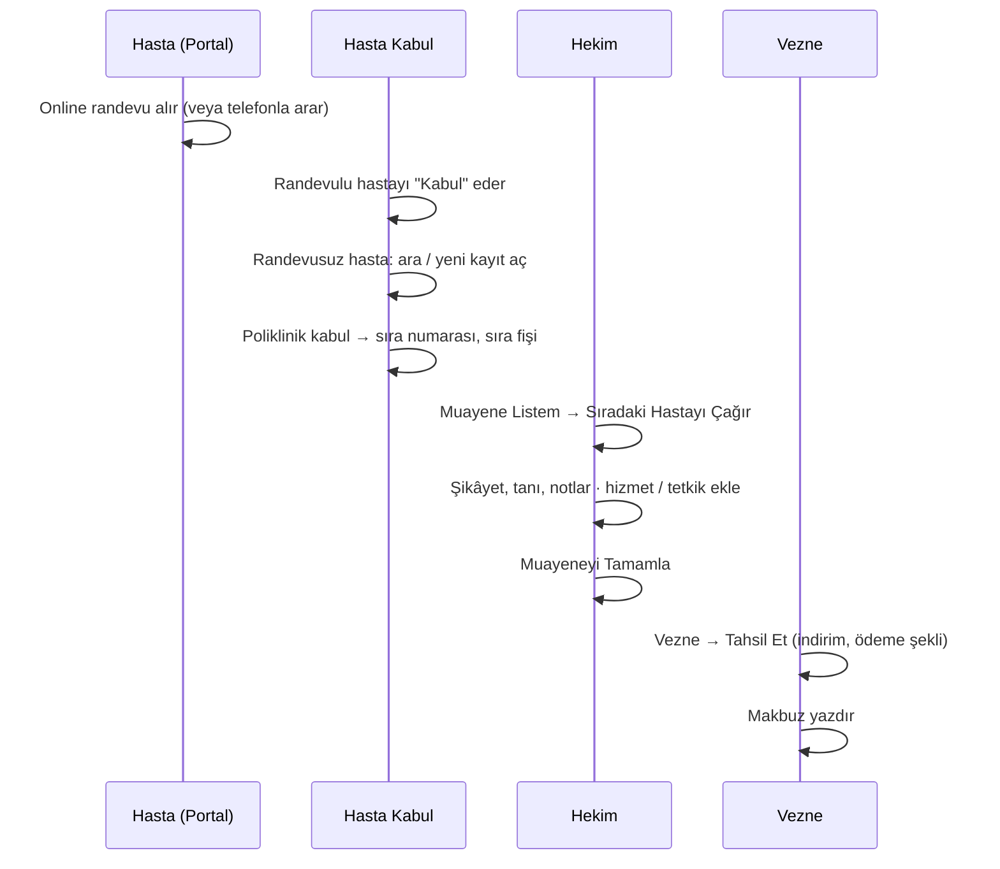

# Kullanım Kılavuzu

Bu kılavuz Klinova'nın günlük kullanımını rollere göre anlatır.

## Roller

| Rol | Kimler kullanır | Erişebildiği ekranlar |
| --- | --- | --- |
| **Yönetici** | Başhekim, idari sorumlu, bilgi işlem | Tüm ekranlar; kullanıcılar, kurum ayarları, işlem kayıtları |
| **Hasta Kabul** | Danışma / kayıt personeli | Hasta kaydı ve arama, poliklinik kabul, başvurular, vezne |
| **Hekim** | Hekimler | Muayene listesi, başvurular, hasta kartları (salt okunur), muayene kaydı |
| **Vezne** | Vezne / muhasebe personeli | Vezne, raporlar, hasta ve başvuru listeleri (tanı ve muayene notları gizli) |
| **Hasta** | Hastalar (hasta portalı) | Online randevu, randevularım, bekleme listesi, profil. Personel ekranlarına erişemez. |

Bir kullanıcıya birden fazla rol verilebilir (ör. küçük bir kurumda kabul personeli aynı zamanda vezne).

## Hasta Portalı (Online Randevu)

Hastalar sitenin ana adresine girdiğinde hasta portalı açılır.

1. **Hesap Oluştur:** T.C. Kimlik No, ad, soyad, doğum tarihi, cep telefonu ve şifre girilir; aydınlatma
   metni onaylanır. Hasta kurumda daha önce kayıtlıysa hesap, bilgiler **ve kayıtlı telefon numarası**
   eşleştiğinde mevcut dosyaya bağlanır. Telefon numarası kayıtlı değilse hasta kabul biriminden eklenmelidir.
2. **Randevu Al:** İl → kurum → poliklinik → hekim ("Fark etmez" ile tüm hekimler) seçilir. Boş saatler
   haftalık olarak listelenir, ilk uygun randevu ayrıca gösterilir. Saat seçilip istenirse hekime not
   bırakılarak randevu onaylanır; randevu kodu ekranda ve Bildirimlerim bölümünde yer alır.
3. **Uygun saat yoksa:** *Bekleme Listesine Yaz* ile hasta, seçtiği tarihe kadar bekleme listesine alınır.
   Bir randevu iptal edildiğinde sıradaki bekleyenlere bildirim gönderilir; boşalan saat ilk alan hastanındır.
4. **Bildirimlerim:** Randevu onayı, bir gün önceki hatırlatma, iptaller ve bekleme listesi haberleri
   burada görünür; okunmamış bildirim sayısı menüde gösterilir. Kurum SMS/e-posta sağlayıcısı tanımladıysa
   aynı mesajlar ayrıca SMS/e-posta ile de gelir.
5. **Randevularım:** Yaklaşan randevular **değiştirilebilir** veya **iptal edilebilir** (varsayılan olarak
   randevudan 2 saat öncesine kadar). Geçmiş randevular ve muayeneler de burada görünür.

**Gelmeme kuralı:** Randevusuna gelmeyen ve iptal etmeyen hasta, aynı poliklinikten 15 gün online randevu
alamaz; bu süre içinde ikinci kez gelmezse kısıtlama tüm polikliniklere uygulanır. Kurum personeli
gerektiğinde telefonla randevu verebilir.

## Randevu Yönetimi (Personel)

- **Randevular** ekranı seçilen günün randevularını kurum, poliklinik, hekim ve duruma göre listeler.
  Hekimler varsayılan olarak kendi randevularını görür.
- **Kabul:** Randevulu hasta geldiğinde *Kabul* düğmesi başvuruyu açar, sıra numarası verir ve muayene
  ücretini ekler. Hasta, hekimin muayene listesine düşer.
- **Randevu Ver:** Hasta kartındaki *Randevu Ver* ile telefonla arayan hastaya randevu verilir.
- **Değiştir / İptal:** Personel her zaman değişiklik ve iptal yapabilir; hastaya bildirim gönderilir.
- **Gelmedi:** Saati geçmiş randevular "gelmedi" olarak işaretlenebilir; işaretlenmeyenler gün bitince
  sistem tarafından otomatik işaretlenir.
- **Bekleme Listesi** ekranı bekleyen hastaları gösterir; buradan doğrudan randevu verilebilir.

## Çalışma Takvimi ve Tatiller (Yönetici)

- **Çalışma Takvimleri:** Her hekim için gün, saat aralığı ve randevu süresi (ör. Pazartesi 09:00–12:00,
  15 dk) tanımlanır. *Hafta içi her güne uygula* ile tek seferde beş gün eklenir. "Online randevuya açık"
  işareti kaldırılan bloklar yalnızca personel tarafından verilebilir.
- **İzin:** Hekim izinliyken randevu verilmez. İzin eklenirken o tarihlerde mevcut randevu varsa uyarı gösterilir.
- **Resmî Tatiller:** Sabit tarihli millî bayramlar otomatik eklenir. Ramazan ve Kurban Bayramı gibi her
  yıl değişen tatilleri ve arife günlerini (yarım gün, ör. 13:00'ten itibaren) her yıl ekleyin.
- **Kurumlar ve Şubeler:** Her şube il ve ilçesiyle tanımlanır; poliklinikler bir şubeye bağlanır ve
  online randevuya açılıp kapatılabilir.
- **Bildirimler:** Gönderilen SMS / e-postalar ve durumları izlenir, başarısız olanlar yeniden denenir.

## Günlük İş Akışı

### 1. Hasta Kabul

1. **Hastalar** ekranında arama kutusuna ad soyad, dosya numarası, T.C. Kimlik No veya
   telefon yazın. Türkçe karakter fark etmez: *ismail*, *İsmail* ve *ISMAIL* aynı sonucu verir.
2. Hasta kayıtlı değilse **Yeni Hasta Kaydı** ile kaydedin. T.C. Kimlik No girilirse
   algoritmik olarak doğrulanır; aynı numarayla ikinci kayıt açılamaz ve mevcut kaydın
   dosya numarası gösterilir.
3. Alerji ve kronik hastalıkları **Tıbbi Uyarılar** alanına yazın; bu bilgi hekim
   ekranlarında kırmızı uyarı olarak görünür.
4. **Poliklinik Kabul** ekranında polikliniği (ve istenirse hekimi) seçin. Muayene ücreti
   varsayılan olarak seçili gelir. **Kabul Et ve Sıra Fişi Yazdır** ile sıra numarası
   verilir ve fiş yazdırılır.

Sıra numaraları her poliklinik için her gün 1'den başlar. Aynı anda iki masadan kabul
yapılsa bile numaralar çakışmaz.

### 2. Hekim

1. **Muayene Listem** ekranı, kullanıcı hesabınız bir hekim kaydına bağlıysa kendi
   polikliniğinizi otomatik açar.
2. **Sıradaki Hastayı Çağır** en küçük sıra numaralı bekleyen hastayı muayeneye alır.
3. Muayene sayfasında şikâyet, tanı ve muayene notlarını kaydedin; gerekirse tetkik
   veya işlem ekleyin.
4. **Muayeneyi Tamamla** ile hasta veznenin listesine düşer. Hasta gelmediyse
   **Sıraya Geri Al** kullanılabilir.

Tahsilatı yapılmamış tamamlanmış bir başvuru **Yeniden Aç** ile düzeltilebilir.

### 3. Vezne

1. **Vezne** ekranında tahsilat bekleyen başvurular listelenir.
2. **Tahsil Et** ile ödeme şeklini (nakit, kart, havale, sigorta/kurum) ve varsa indirimi girin.
3. Makbuz numarası `MKB-xxxxxxxx` biçiminde otomatik verilir ve A4 makbuz yazdırılabilir.
4. Gün sonunda aynı ekranın alt bölümünde ödeme şekline göre kasa toplamları görünür.

Tahsilatı yapılan başvurunun hizmetleri değiştirilemez; bu, mali kayıtların tutarlılığını korur.

### 4. Raporlar

**Raporlar** ekranında tarih aralığı seçerek (hazır aralıklar: bugün, son 7 gün, bu ay,
geçen ay, bu yıl) net/brüt gelir, indirimler ve başvuru sayılarını; poliklinik, hekim,
hizmet ve ödeme şekli kırılımlarını görebilir, **Excel (CSV) İndir** ile dışa aktarabilirsiniz.

## Yönetim

- **Poliklinikler:** Pasif yapılan poliklinik kabul ekranında görünmez; geçmiş kayıtlar korunur.
- **Hekimler:** Hekimi "Hekim" rolündeki bir kullanıcı hesabına bağlayın.
- **Fiyat Listesi:** Fiyat değişikliği yalnızca sonradan eklenen hizmetlere yansır;
  geçmiş başvurular eklendikleri andaki fiyatı korur.
- **Kullanıcılar:** Yeni hesaplara tek seferlik geçici şifre üretilir. Ayrılan personelin
  hesabını silmek yerine pasifleştirin; açık oturumları birkaç dakika içinde sonlanır.
  Sistemde her zaman en az bir aktif yönetici kalır.
- **İşlem Kayıtları:** Hangi kaydın kim tarafından ne zaman eklendiği/değiştirildiği,
  eski ve yeni değerleriyle listelenir.

## Sık Sorulan Sorular

**Şifremi unuttum.** Yöneticiniz **Kullanıcılar** ekranından şifrenizi sıfırlayabilir.

**Hesabım kilitlendi.** Beş hatalı denemeden sonra hesap 15 dakika kilitlenir. Yönetici
şifre sıfırlayarak kilidi hemen açabilir.

**Hasta yanlışlıkla iki kez kaydedildi.** Kayıtlardan birini arşivleyin. Arşivlenen
hastalar aramalarda varsayılan olarak görünmez ve yeni başvuru açılamaz.
